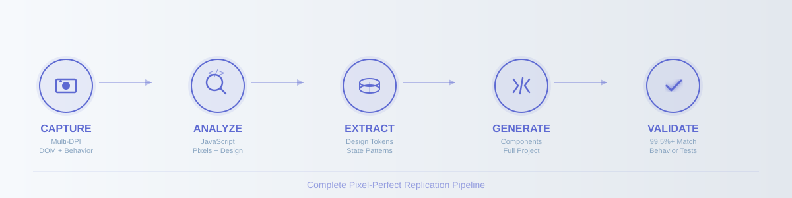
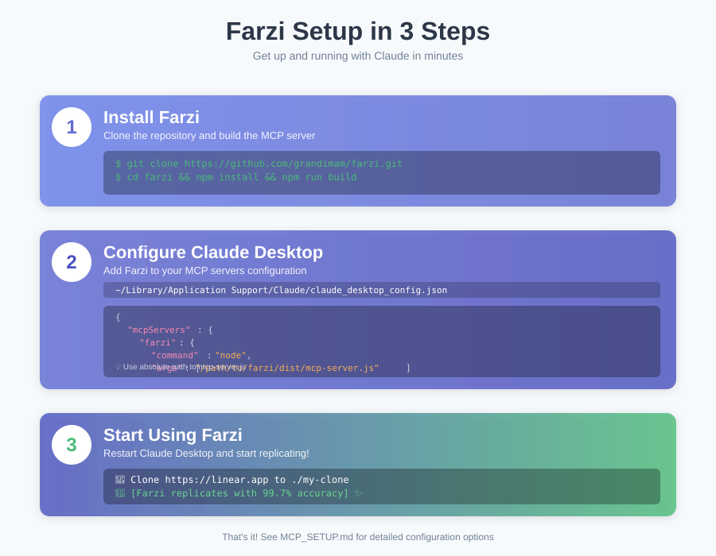
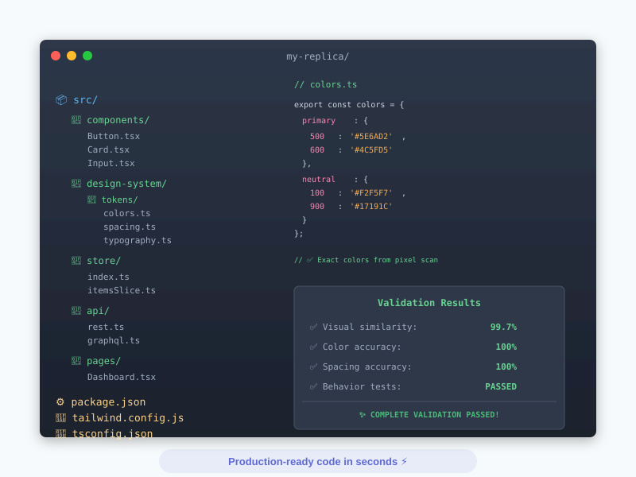

<div align="center">

```
███████╗ █████╗ ██████╗ ███████╗██╗
██╔════╝██╔══██╗██╔══██╗╚══███╔╝██║
█████╗  ███████║██████╔╝  ███╔╝ ██║
██╔══╝  ██╔══██║██╔══██╗ ███╔╝  ██║
██║     ██║  ██║██║  ██║███████╗██║
╚═╝     ╚═╝  ╚═╝╚═╝  ╚═╝╚══════╝╚═╝
```

### **Pixel-Perfect Application Replication via MCP**

*فرضی • फ़र्ज़ी • "replica"*

Clone any web app with complete behavior and design understanding

[](https://opensource.org/licenses/MIT)
[](https://www.typescriptlang.org/)
[](https://modelcontextprotocol.io/)
[](https://nodejs.org/)

[Quick Start](#-quick-start) •
[Features](#-what-farzi-does) •
[Setup Guide](./MCP_SETUP.md) •
[Examples](./USAGE_EXAMPLES.md) •
[Architecture](./ARCHITECTURE.md)

</div>

---

## 🎯 What is Farzi?

Farzi is an **MCP server** that gives Claude superpowers to replicate any web application. Unlike screenshot-to-code tools, Farzi **understands behavior** (JavaScript, state, APIs) and **extracts design** (pixel-perfect tokens) to generate production-ready code.

### The Problem

```
Traditional Tools           →  Static HTML/CSS
Screenshot-to-Code         →  No behavior understanding
Reverse Engineering Tools  →  No code generation
```

### The Farzi Solution

```
🔍 Analyze Behavior        →  JavaScript, State, APIs, Events
🎨 Extract Design          →  Pixel scanning + DOM styles
⚡ Generate Code           →  React/Vue/Svelte components
✅ Validate Accuracy       →  99.5%+ pixel similarity
```

**Result:** Complete, working applications — not just pretty HTML.

---

## 🔄 The Farzi Workflow

<div align="center">

</div>

---

## ✨ What Farzi Does

<table>
<tr>
<td width="50%">

### 🔍 **Behavioral Analysis**

- ✅ JavaScript module graphs
- ✅ React/Vue/Svelte components
- ✅ State management (Redux, Zustand, Context, MobX)
- ✅ API endpoints (REST, GraphQL, WebSocket)
- ✅ Event handlers & interactions
- ✅ Framework detection

</td>
<td width="50%">

### 🎨 **Design Extraction**

- ✅ Multi-DPI screenshots (1x, 2x, 4x)
- ✅ Pixel-perfect color scanning
- ✅ DOM computed styles
- ✅ Spacing system detection
- ✅ Typography analysis
- ✅ Component variants

</td>
</tr>
</table>

### ⚡ **Code Generation**

Generates complete project structure:

```
output/
├── 📦 src/
│   ├── 🧩 components/          # UI components with behavior
│   ├── 🎨 design-system/       # Design tokens + primitives
│   ├── 🗃️  store/               # State management (auto-detected)
│   ├── 🌐 api/                  # Type-safe API clients
│   └── 📄 pages/                # Page components
├── ⚙️  package.json             # Dependencies installed
├── 🎨 tailwind.config.js       # Design system as config
└── 📘 tsconfig.json            # TypeScript ready
```

### ✅ **Validation**

- **Pixel-diff comparison** (99.5%+ target)
- **Behavior testing** (interactions, forms, navigation)
- **Component parity** (props, states, variants)

---

## 🚀 Quick Start

<div align="center">

</div>

### 1️⃣ Install Farzi

```bash
git clone https://github.com/grandimam/farzi.git
cd farzi
npm install
npm run build
```

### 2️⃣ Configure Claude Desktop

**macOS:** `~/Library/Application Support/Claude/claude_desktop_config.json`
**Windows:** `%APPDATA%\Claude\claude_desktop_config.json`

```json
{
  "mcpServers": {
    "farzi": {
      "command": "node",
      "args": ["/absolute/path/to/farzi/dist/mcp-server.js"],
      "env": {
        "ANTHROPIC_API_KEY": "sk-ant-... (optional)"
      }
    }
  }
}
```

> 💡 **API Key Optional:** Farzi works without it using pixel+DOM analysis. With it, Claude Vision enhances semantic understanding.

### 3️⃣ Restart Claude Desktop

### 4️⃣ Use It!

Just talk to Claude:

```
👤 Clone https://linear.app to ./my-clone

🤖 I'll use Farzi to replicate Linear...
   [Uses farzi_replicate tool]

   ✅ Replicated successfully!
   - Framework: React + TypeScript
   - State: Redux Toolkit
   - Components: 47 generated
   - Similarity: 99.7%
```

---

## 🛠️ MCP Tools

Farzi exposes 5 tools that Claude uses automatically:

| Tool | Description | Use Case |
|------|-------------|----------|
| 🎯 **`farzi_replicate`** | Complete app replication | Clone entire applications |
| 🎨 **`farzi_extract_design`** | Design token extraction | Build design systems |
| 🔍 **`farzi_analyze`** | Technical analysis | Understand tech stacks |
| 🧩 **`farzi_extract_component`** | Single component extraction | Component libraries |
| ✅ **`farzi_validate`** | Replica validation | Quality assurance |

---

## 💡 Usage Examples

### Clone a Complete App

```
👤 Clone https://linear.app to ./linear-clone using React
```

Claude will:
- Capture screenshots at multiple DPIs
- Analyze JavaScript modules and state
- Extract design tokens
- Generate complete React project
- Validate 99.5%+ similarity

---

### Extract Design System

```
👤 What design tokens does Stripe use?
```

Claude will use `farzi_extract_design` and show:
- **Colors:** Primary palette, neutrals, semantics
- **Spacing:** Base unit, scale system
- **Typography:** Families, sizes, weights
- **Components:** Variants detected

---

### Analyze Tech Stack

```
👤 Analyze the architecture of GitHub's PR page
```

Claude will report:
- Framework (React/Vue/Svelte)
- State management pattern
- API endpoints (REST/GraphQL)
- Component count
- Event listeners

---

### Build Component Library

```
👤 Extract all button variants from Vercel and create a unified component
```

Claude will:
- Extract each variant
- Identify patterns
- Generate consolidated component
- Include all states (hover, active, disabled)

---

## 🎬 Real-World Scenarios

| Scenario | Example |
|----------|---------|
| 🎨 **Design System Extraction** | "Extract Stripe's design tokens" |
| 🚀 **Rapid Prototyping** | "Clone Excalidraw as a starting point" |
| 🔄 **Framework Migration** | "Convert this Vue app to React" |
| 🧩 **Component Libraries** | "Extract all cards from Airbnb" |
| 🕵️ **Competitive Analysis** | "How does Notion implement their editor?" |
| ✅ **Quality Assurance** | "Validate my replica is 99%+ accurate" |

👉 See [USAGE_EXAMPLES.md](./USAGE_EXAMPLES.md) for detailed walkthroughs.

---

## 🏗️ Architecture

<div align="center">

```
┌─────────────────────────────────────────────────────────────┐
│                      MCP SERVER (stdio)                      │
│  farzi_replicate • farzi_analyze • farzi_extract_design     │
└────────────────────────┬────────────────────────────────────┘
                         │
         ┌───────────────┴───────────────┐
         ▼                               ▼
┌─────────────────┐            ┌─────────────────┐
│  CAPTURE LAYER  │            │ ANALYSIS LAYER  │
├─────────────────┤            ├─────────────────┤
│ • Multi-DPI     │            │ • JavaScript    │
│ • DOM Styles    │────────────│ • Pixel Scan    │
│ • Behavior      │            │ • Spacing       │
│ • Network       │            │ • Vision (opt)  │
└────────┬────────┘            │ • State Pattern │
         │                     └────────┬────────┘
         │                              │
         └──────────┬───────────────────┘
                    ▼
         ┌─────────────────────┐
         │ EXTRACTION LAYER    │
         ├─────────────────────┤
         │ • Design Tokens     │
         │ • Complete Analysis │
         └──────────┬──────────┘
                    ▼
         ┌─────────────────────┐
         │ GENERATION LAYER    │
         ├─────────────────────┤
         │ • Components        │
         │ • State Management  │
         │ • API Clients       │
         │ • Project Structure │
         └──────────┬──────────┘
                    ▼
         ┌─────────────────────┐
         │ VALIDATION LAYER    │
         ├─────────────────────┤
         │ • Pixel Diff        │
         │ • Behavior Tests    │
         └─────────────────────┘
```

</div>

**Self-Contained:** No dependencies on external RE tools. Everything implemented internally.

👉 See [ARCHITECTURE.md](./ARCHITECTURE.md) for technical deep-dive.

---

## 🎯 Generated Code Examples

<div align="center">

</div>

### Design Tokens

```typescript
// src/design-system/tokens/colors.ts
export const colors = {
  primary: {
    500: '#5E6AD2',  // ← Exact from pixel scanning
    600: '#4C5FD5'
  },
  neutral: {
    100: '#F2F5F7',
    900: '#17191C'
  }
};
```

### Components with Behavior

```typescript
// src/design-system/components/Button.tsx
export const Button: React.FC<ButtonProps> = ({
  variant = 'primary',
  children,
  onClick,
  ...props
}) => {
  return (
    <button
      className={cn(
        'px-6 py-3 text-base font-medium rounded-lg transition-colors',
        variant === 'primary' && 'bg-primary-500 hover:bg-primary-600',
        variant === 'secondary' && 'bg-neutral-100 hover:bg-neutral-200'
      )}
      onClick={onClick}
      {...props}
    >
      {children}
    </button>
  );
};
```

### State Management

```typescript
// src/store/index.ts (if Redux detected)
import { configureStore } from '@reduxjs/toolkit';
import itemsReducer from './itemsSlice';

export const store = configureStore({
  reducer: {
    items: itemsReducer
  }
});
```

### API Clients

```typescript
// src/api/rest.ts
export const api = {
  getItems: () => apiClient.get<ItemsResponse>('/api/items'),
  createItem: (data: CreateItemRequest) =>
    apiClient.post<Item>('/api/items', data),
  updateItem: (id: string, data: UpdateItemRequest) =>
    apiClient.put<Item>(`/api/items/${id}`, data)
};
```

---

## 📊 Comparison Matrix

<table>
<thead>
<tr>
<th>Feature</th>
<th>Farzi</th>
<th>Screenshot-to-Code</th>
<th>Traditional RE</th>
</tr>
</thead>
<tbody>
<tr>
<td><strong>Visual Analysis</strong></td>
<td>✅ Multi-DPI pixel scanning</td>
<td>✅ Single screenshot</td>
<td>❌</td>
</tr>
<tr>
<td><strong>Behavior Analysis</strong></td>
<td>✅ JS + State + APIs</td>
<td>❌</td>
<td>✅</td>
</tr>
<tr>
<td><strong>Code Generation</strong></td>
<td>✅ Full projects</td>
<td>✅ HTML/CSS only</td>
<td>❌</td>
</tr>
<tr>
<td><strong>Framework Detection</strong></td>
<td>✅ React, Vue, Svelte</td>
<td>❌</td>
<td>❌</td>
</tr>
<tr>
<td><strong>State Management</strong></td>
<td>✅ All major patterns</td>
<td>❌</td>
<td>❌</td>
</tr>
<tr>
<td><strong>API Extraction</strong></td>
<td>✅ REST + GraphQL</td>
<td>❌</td>
<td>✅</td>
</tr>
<tr>
<td><strong>Validation</strong></td>
<td>✅ Pixel-diff + Behavior</td>
<td>❌</td>
<td>❌</td>
</tr>
<tr>
<td><strong>MCP Integration</strong></td>
<td>✅ Native</td>
<td>❌</td>
<td>❌</td>
</tr>
<tr>
<td><strong>AI Optional</strong></td>
<td>✅ Works without AI</td>
<td>❌ AI required</td>
<td>✅</td>
</tr>
</tbody>
</table>

**Farzi is the only tool combining behavior understanding with pixel-perfect replication.**

---

## 🎓 How It Works

### Without AI (Default)

```
Pixel Scanning  →  Exact hex colors from bitmap
DOM Inspection  →  Computed styles (font, spacing, etc.)
AST Parsing     →  JavaScript behavior analysis
Pattern Match   →  State management detection
```

### With AI (Optional)

All of the above, **plus:**

```
Claude Vision   →  Semantic understanding
                →  Enhanced component recognition
                →  Better design system inference
```

---

## ✅ Capabilities

<div align="center">

| Capture | Analysis | Generation | Validation |
|---------|----------|------------|------------|
| 📸 Multi-DPI Screenshots | 📦 JavaScript Modules | ⚛️ React Components | 🔍 Pixel Diff |
| 🌳 DOM Styles | 🎨 Design Tokens | 💚 Vue Components | ✅ Behavior Tests |
| 🎬 Behavior Events | 🗃️ State Patterns | 🔶 Svelte Components | 📊 Similarity Score |
| 🌐 Network Requests | 🎯 Framework Detection | 🏗️ Project Structure | 📈 Quality Report |
| 🖱️ Interactions | 📐 Spacing Systems | 🎨 Tailwind Config | ⚡ Regression Check |

</div>

---

## 🚧 Current Limitations

### ✅ Supported

- Web applications (any URL)
- Single-page apps (SPAs)
- Server-rendered sites
- Public pages

### ❌ Not Yet Supported

- Native desktop applications
- Mobile apps (iOS/Android)
- Electron/Tauri apps
- Browser extensions
- Native binaries

> 🔮 **Future:** Binary support planned using runtime instrumentation.

---

## 📚 Documentation

- 📖 [MCP Setup Guide](./MCP_SETUP.md) - Detailed configuration
- 💡 [Usage Examples](./USAGE_EXAMPLES.md) - 8 real-world scenarios
- 🏗️ [Architecture](./ARCHITECTURE.md) - Technical deep-dive
- 🤔 [Why Farzi](./WHY_FARZI.md) - Philosophy & approach
- ✅ [Status](./STATUS.md) - Implementation status

---

## 🛡️ Requirements

- **Node.js** 18+
- **Playwright** (browsers auto-installed)
- **Anthropic API Key** (optional, for AI enhancement)

---

## 🤝 Contributing

Issues and PRs welcome!

```bash
git clone https://github.com/grandimam/farzi.git
cd farzi
npm install
npm run dev      # Watch mode
npm run build    # Production build
npm test         # Run tests
```

---

## 📜 License

MIT © [Farzi Contributors](https://github.com/grandimam/farzi/graphs/contributors)

---

<div align="center">

### 🎯 **Farzi: Complete application replication via MCP**

**Understand behavior. Extract design. Generate code.**

[⭐ Star on GitHub](https://github.com/grandimam/farzi) •
[🐛 Report Issue](https://github.com/grandimam/farzi/issues) •
[💬 Discuss](https://github.com/grandimam/farzi/discussions)

---

*Built with ❤️ for the MCP ecosystem*

</div>
